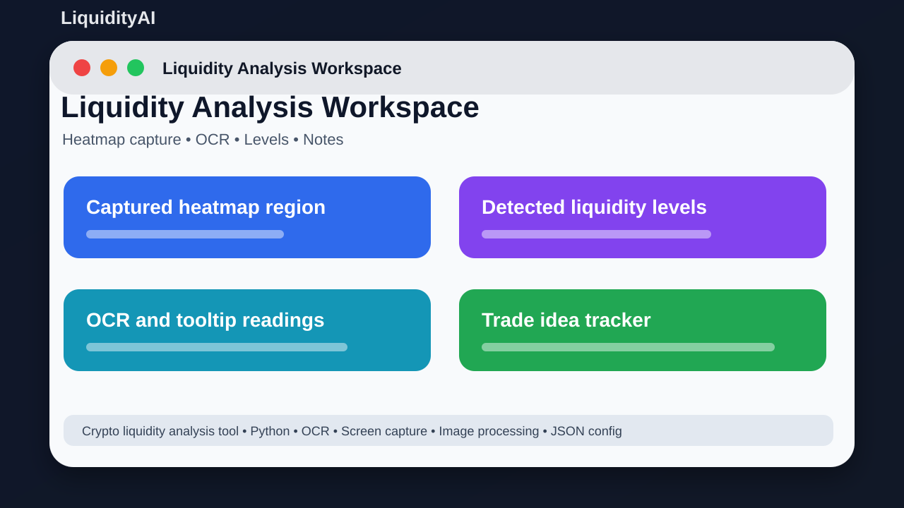
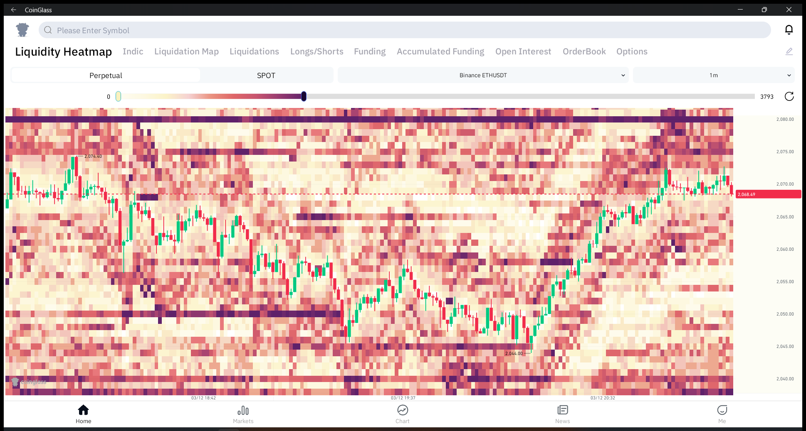
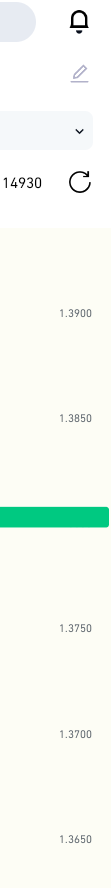

# LiquidityAI



## Short Description

Capture liquidity screen data, read text, and study possible trading zones.

## About This Project

LiquidityAI is a Python project for studying crypto liquidity and heatmaps. It uses screen capture, OCR, image processing, configuration files, and analysis modules to help research possible trading ideas.

The goal is to keep the project easy to understand, easy to run, and useful for learning or further development.

## Purpose And Idea

**Purpose:** The purpose of this project is to study crypto liquidity and heatmap information from screen captures.

**Idea:** The idea is to capture market-related screen data, read important text with OCR, detect liquidity zones, and keep notes or trade ideas for research.

**Why I made it:** I made this to learn how OCR, screen capture, image processing, and trading research can work together in a Python project.

## Screenshots

### Real liquidity window capture



### Real liquidity axis capture



### Project preview


## Main Features

- Capture screen information
- Read screen text with OCR
- Analyze heatmap/liquidity areas
- Use Coinglass-style automation helpers
- Track trades and logs
- Configure pairs and macros
- Use prediction/learning modules for research

## Tech Stack

- Python
- OCR
- Screen capture
- Image processing
- JSON config

## Project Location

Main local folder:

```text
D:\PROJECTS\LiquidityAI\LiquidityAI
```

GitHub repository:

https://github.com/saifalian/LiquidityAI

## Project Structure

```text
LiquidityAI/
main.py        Main launcher
ui_main.py     Main UI file
modules/       Capture, OCR, liquidity, prediction, and automation modules
config.json    App configuration
pairs.json     Trading pair list
```

## How To Run

1. Go into the LiquidityAI folder.
2. Create and activate a Python virtual environment.
3. Install requirements.txt.
4. Run python main.py.
5. Calibrate screen areas before using analysis tools.

## Current Status

This project is uploaded to GitHub and prepared as a portfolio-style repository. More improvements can be added later, such as real app screenshots, demo videos, releases, and issue templates.

## Safety Note

Use as a research helper only. Always check results manually before making any trading decision.

## License

No license file is included yet. Add a license before using this project as an open-source project.
